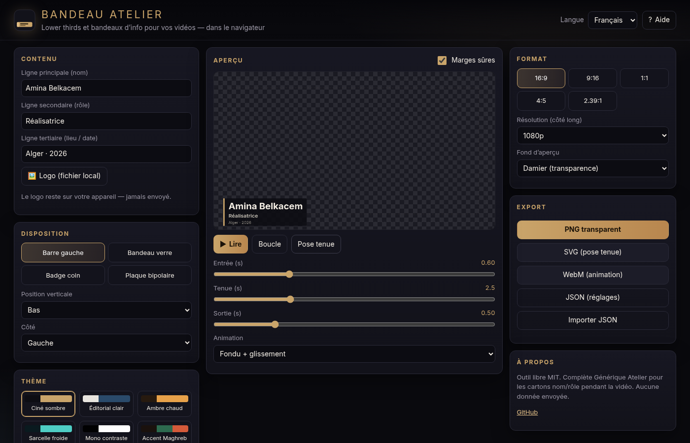

# Bandeau Atelier

Générateur de **bandeaux** (lower thirds / name supers) pour vidéastes et YouTubers — 100 % dans le navigateur, sans compte ni serveur.

**Démo :** [https://salimadour31-boop.github.io/bandeau-atelier/](https://salimadour31-boop.github.io/bandeau-atelier/)

> **EN** — Free browser lower-thirds / name-super / info-banner generator: 4 original layouts, 6 color themes, in/hold/out animation, Arabic RTL + Tifinagh fonts, PNG / SVG / WebM / JSON export. Complements [generique-atelier](https://github.com/salimadour31-boop/generique-atelier) (end credits). MIT.

## Fonctionnalités

- **Contenu** : ligne principale (nom), secondaire (rôle), tertiaire (lieu / date), logo local (jamais envoyé)
- **4 dispositions originales** : barre gauche + texte, bandeau verre, badge coin, plaque bipolaire
- **6 thèmes** : ciné sombre, éditorial clair, ambre chaud, sarcelle froide, mono contraste, accent Maghreb
- **Animation** : fondu + glissement, croissance, fondu, balayage — durées entrée / tenue / sortie réglables, lecture et boucle
- **Formats** : 16:9, 9:16, 1:1, 4:5, 2.39:1 — 720p / 1080p / 4K — guides de marges sûres
- **Typographie** : Inter, Source Sans 3, Josefin Sans, Noto Sans Arabic (RTL auto), Noto Sans Tifinagh, system-ui (polices OFL / système)
- **Export** : PNG transparent, SVG (pose tenue), WebM (animation), JSON (réglages + import)
- **Langues** : français (défaut), anglais, taqbaylit (kabyle)

## Utilisation

1. Ouvrez la [démo](https://salimadour31-boop.github.io/bandeau-atelier/) ou `index.html` en local (ou via un serveur statique).
2. Saisissez nom / rôle / lieu, choisissez disposition et thème.
3. Réglez l’animation, prévisualisez (Lire / Boucle / Pose tenue).
4. Exportez PNG (calque transparent), SVG, WebM ou JSON.

Aucun build : HTML + CSS + JS vanilla. Fonctionne sur GitHub Pages depuis `/` ou `/bandeau-atelier/`.

## Capture

## Licence

[MIT](LICENSE) — © 2026 Amirouche Amwanes. Aucun traceur, aucune API payante, ressources libres uniquement.
